# Архитектура платформы шеринга рецептов и планирования меню Л.Р. №1

## 1. Назначение системы

Платформа предназначена для публикации кулинарных рецептов с возможностью их модерации и автоматического пересчёта ингредиентов под заданное количество порций. Система позволяет пользователям создавать списки покупок на основе выбранных блюд.

Основные роли:
* **Кулинар** — публикует рецепты, создаёт списки покупок.
* **Шеф-редактор** — проверяет новые рецепты перед публикацией.

## 2. Роли и Use Cases

### Кулинар
* Регистрация / Вход в систему
* Просмотр популярных рецептов
* Поиск рецепта по ингредиентам или названию
* Создание нового рецепта *(автор обязательно)*
* Редактирование собственного рецепта
* Удаление собственного рецепта
* Добавление/изменение списка ингредиентов к рецепту *(обязательно)*
* Генерация списка покупок на основе выбранного блюда *(автоматически системой)*

### Шеф-редактор
* Проверка новых рецептов *(публикация / отклонение; обязательный модератор)*
* Управление категориями блюд *(добавление новой категории)*.
* Просмотр аналитических отчётов о популярности категорий.

### Система
*(Автоматические действия)*
* Пересчёт количества ингредиентов при изменении числа порций.
* Формирование списка покупок из рецептурных ингредиентов.

---

## 3. Диаграмма C4 Container

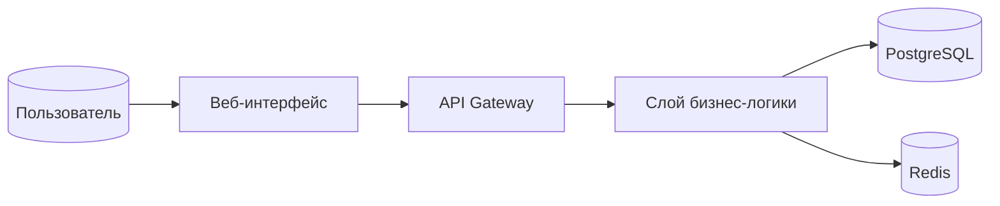

## 4. Модель данных (ERD, 3NF)

База данных спроектирована в третьей нормальной форме (3NF).

### Таблицы

#### users — пользователи
* `id` *(PK, UUID)* — уникальный идентификатор пользователя.
* `email` *(varchar, UNIQUE, NOT NULL)* — адрес электронной почты.
* `password_hash` *(varchar, NOT NULL)* — хеш пароля.
* `role` *(enum, NOT NULL)* — роль (`culinarian` / `chef_editor`).

#### categories — категории блюд
* `id` *(PK, int)* — идентификатор категории.
* `name` *(varchar, UNIQUE, NOT NULL)* — название категории (закуски, супы, десерты).

#### ingredients — справочник ингредиентов
* `id` *(PK, int)* — идентификатор ингредиента.
* `name` *(varchar, UNIQUE, NOT NULL)* — название (мука пшеничная, сахар, соль).
* `unit` *(varchar, NOT NULL)* — единица измерения (г, мл, шт.).

#### recipes — рецепты
* `id` *(PK, UUID)* — идентификатор рецепта.
* `title` *(varchar, NOT NULL)* — заголовок.
* `description` *(text, NOT NULL)* — описание приготовления.
* `cooking_time` *(int, NOT NULL)* — время готовки в минутах.
* `servings_base` *(int, NOT NULL)* — базовое число порций (для расчёта ингредиентов).
* `status` *(enum, DEFAULT 'pending', NOT NULL)* — статус (`pending` — на модерации, `published` — опубликован, `rejected` — отклонён).
* `author_id` *(FK → users.id, NOT NULL)* — автор рецепта *(обязательный)*.
* `moderator_id` *(FK → users.id, NOT NULL)* — кто модерировал *(обязательный)*.
* `category_id` *(FK → categories.id, NOT NULL)* — категория *(обязательная)*.

#### recipe_ingredients — состав рецепта (связь N:M)
Эта таблица реализует связь «многие ко многим» между рецептами и ингредиентами.

* `recipe_id` *(FK → recipes.id, NOT NULL)* — ссылка на рецепт.
* `ingredient_id` *(FK → ingredients.id, NOT NULL)* — ссылка на ингредиент.
* `quantity` *(decimal(10,2), NOT NULL)* — количество на базовое число порций.

*(Комбинированный первичный ключ: `(recipe_id, ingredient_id)`)*.

#### shopping_lists — списки покупок
* `id` *(PK, UUID)* — идентификатор списка.
* `user_id` *(FK → users.id, NOT NULL)* — владелец списка.
* `total_servings` *(int, NOT NULL)* — общее число порций (на сколько человек рассчитывается список).
* `created_at` *(timestamp with time zone, DEFAULT NOW(), NOT NULL)* — дата создания.

*(В этой таблице нет прямой ссылки на рецепт. Список формируется динамически на основе рецептурных ингредиентов.)*

---

### 5. Связи

* `users` ⟷N `recipes`: один пользователь может иметь много рецептов *(через author_id)*.
* `categories` ⟷N `recipes`: одна категория объединяет множество рецептов *(через category_id)*.
* `recipes` N⟹M `ingredients`: один рецепт содержит несколько ингредиентов, один ингредиент входит во многие рецепты *(через связующую таблицу recipe_ingredients)*.
* `users` ⟷N `shopping_lists`: один пользователь может создать много списков покупок *(через user_id)*.

---

## 6. Приложение. Визуальная ERD

Картинка ER-диаграммы доступна здесь: 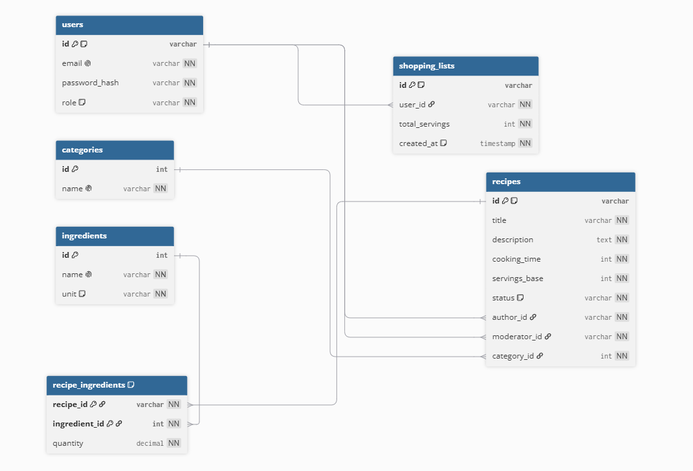

# 7. REST API ЛР №2

## 7.1. Общие сведения

API предоставляет интерфейс для взаимодействия веб-клиента
с серверной частью платформы шеринга рецептов.

Базовый путь API: `/api/v1`.

Формат обмена данными: JSON.

Для защищённых операций используется Bearer-токен.
Доступ к операциям определяется ролью пользователя и правами
на конкретный ресурс.

## 7.2. Таблица эндпоинтов

| Метод | URI | Описание | Доступ | Успешный ответ |
|---|---|---|---|---|
| POST | `/api/v1/auth/register` | Регистрация кулинара | Все | 201 Created |
| POST | `/api/v1/auth/login` | Вход в систему | Все | 200 OK |
| GET | `/api/v1/recipes` | Список опубликованных рецептов | Все | 200 OK |
| GET | `/api/v1/recipes/{id}` | Получение рецепта | Все | 200 OK |
| POST | `/api/v1/recipes` | Создание рецепта | Author | 201 Created |
| PUT | `/api/v1/recipes/{id}` | Полное обновление своего рецепта | Author, владелец | 200 OK |
| DELETE | `/api/v1/recipes/{id}` | Удаление своего рецепта | Author, владелец | 204 No Content |
| PATCH | `/api/v1/recipes/{id}/status` | Публикация или отклонение рецепта | Editor | 200 OK |
| POST | `/api/v1/recipes/{id}/calculations` | Пересчёт ингредиентов | Все | 200 OK |
| GET | `/api/v1/categories` | Получение категорий | Все | 200 OK |
| GET | `/api/v1/ingredients` | Получение справочника ингредиентов | Авторизованный | 200 OK |
| POST | `/api/v1/shopping-lists` | Создание списка покупок | Авторизованный | 201 Created |
| GET | `/api/v1/shopping-lists` | Списки покупок текущего пользователя | Авторизованный | 200 OK |
| GET | `/api/v1/shopping-lists/{id}` | Получение списка покупок | Владелец | 200 OK |
| DELETE | `/api/v1/shopping-lists/{id}` | Удаление своего списка покупок | Владелец | 204 No Content |

## 7.3. Параметры запросов

Для получения списка рецептов поддерживаются query-параметры:

- `page` — номер страницы;
- `limit` — количество элементов на странице;
- `category_id` — фильтрация по категории.

Параметр `id` в URI является path-параметром и указывает
идентификатор конкретного рецепта или списка покупок.

Данные для создания и обновления ресурсов передаются
в теле HTTP-запроса в формате JSON.

## 7.4. Коды ответов

- `200 OK` — запрос выполнен успешно;
- `201 Created` — ресурс создан;
- `204 No Content` — операция выполнена, тело ответа отсутствует;
- `400 Bad Request` — некорректные данные запроса;
- `401 Unauthorized` — отсутствует действительная аутентификация;
- `403 Forbidden` — недостаточно прав;
- `404 Not Found` — ресурс не найден;
- `409 Conflict` — конфликт данных;
- `500 Internal Server Error` — внутренняя ошибка сервера.

Ошибки возвращаются в едином формате `ErrorResponse`,
определённом в спецификации `openapi.yaml`.

## 7.5. Спецификация OpenAPI

Полный контракт API находится в файле `openapi.yaml`
в корне репозитория.

Спецификация описывает эндпоинты, параметры, модели запросов
и ответов, схему авторизации и возможные ошибки.

### Скриншоты Swagger UI

**1. Общий список эндпоинтов**
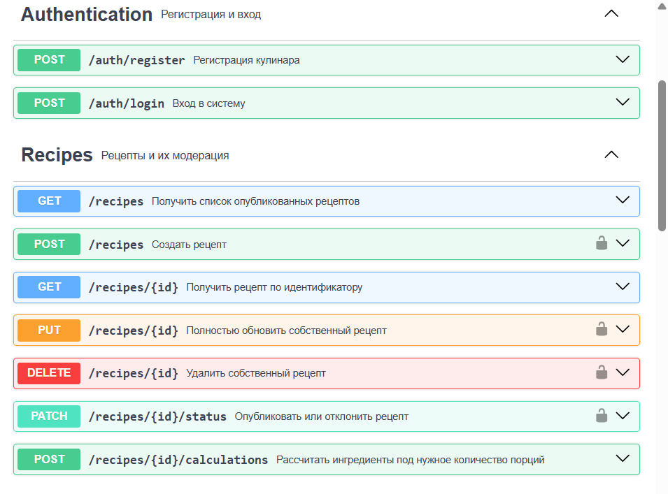

**2. Схема запроса для создания рецепта**
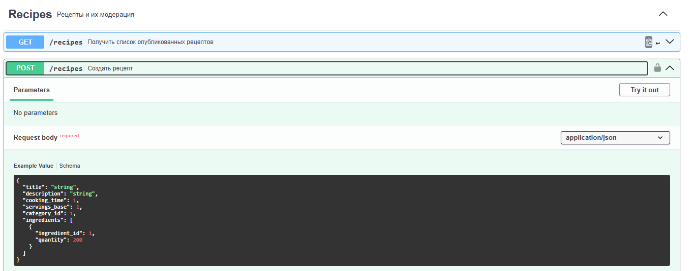

**3. Успешный ответ и ошибка валидации**
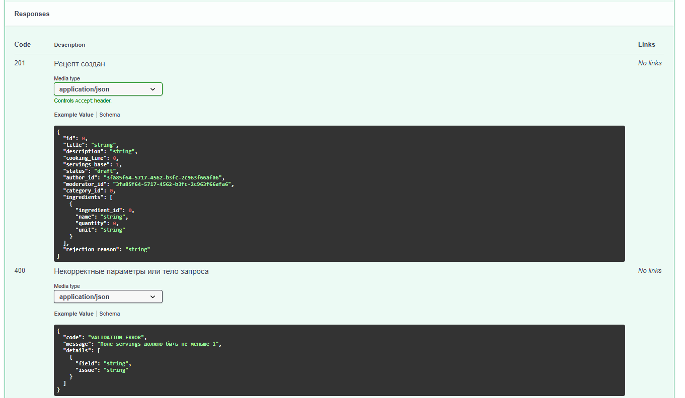

**4. Ошибки авторизации и отсутствия данных**
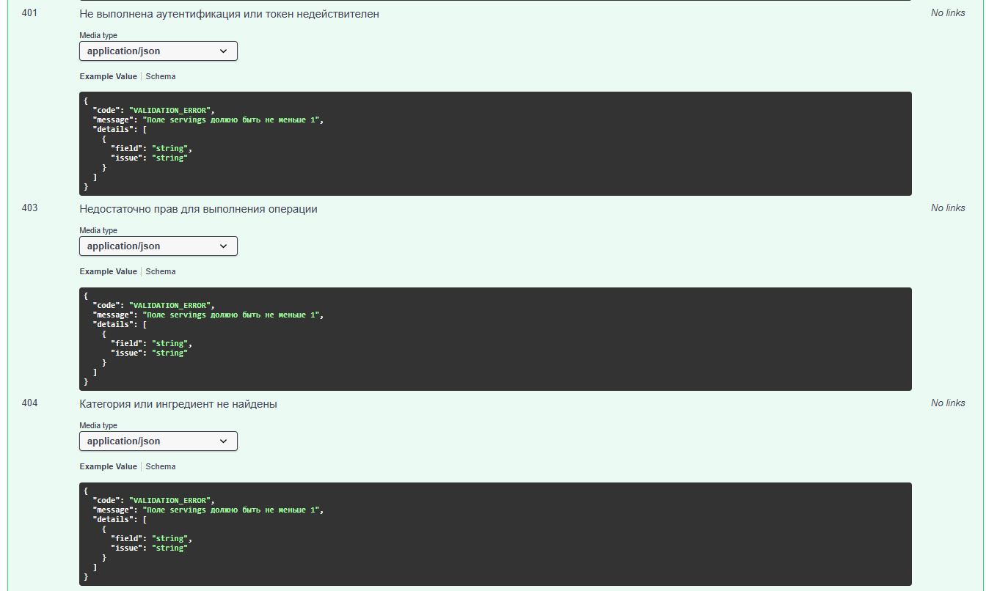

**5. Внутренняя ошибка сервера**
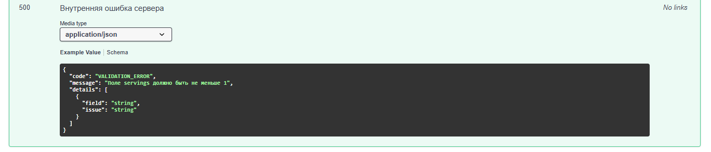

## 8. Контейнеризация (Docker) ЛР №4

Для обеспечения одинаковой работы приложения на любых серверах (исключая проблему «у меня локально работает, а на сервере нет») проект упакован в Docker-контейнер.

### 8.1. Настройка сборки
- **Базовый образ:** `node:20-alpine` — легковесный образ на базе Linux (занимает минимум места, так как не содержит лишних системных утилит).
- **Dockerfile:** Выполняет установку зависимостей из `package.json`, копирование исходного кода и запуск приложения через `node src/app.js`.
- **.dockerignore:** Исключает из контекста сборки папку `node_modules` (библиотеки устанавливаются заново внутри контейнера), файл `.env` (секреты передаются при запуске), а также служебные файлы Git и документацию.

### 8.2. Запуск контейнера
Контейнер запускается с пробросом порта `3000` наружу. 
Переменные окружения (`PORT`, `APP_NAME`, `NODE_ENV`) передаются в контейнер при запуске, чтобы приложение работало в правильном режиме (production).

### 8.3. Скриншоты работы Docker

**Собранный Docker-образ (Images):**
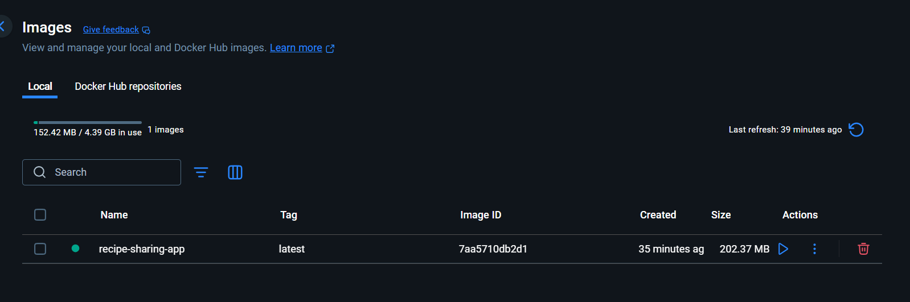

**Запущенный контейнер (Containers):**
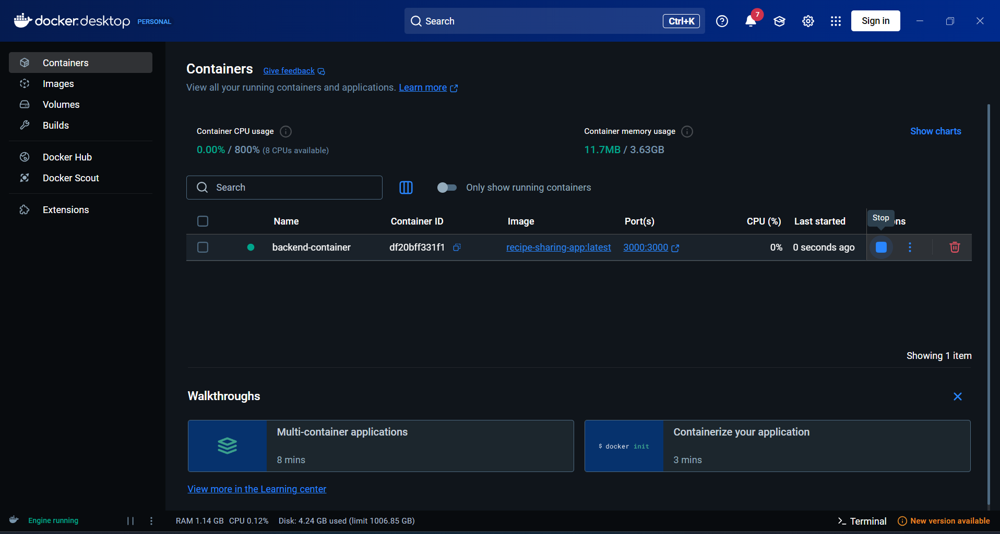

**Проверка работоспособности эндпоинта /health внутри контейнера:**
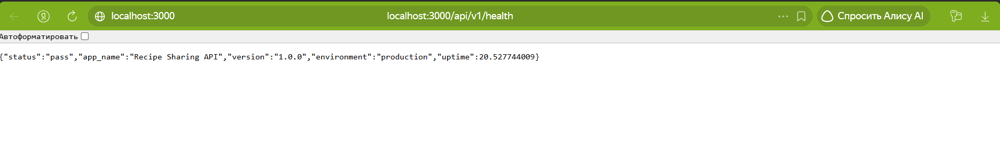

## 10. Результаты проверки ЛР №5

**1. Запущенные контейнеры и созданные таблицы:**
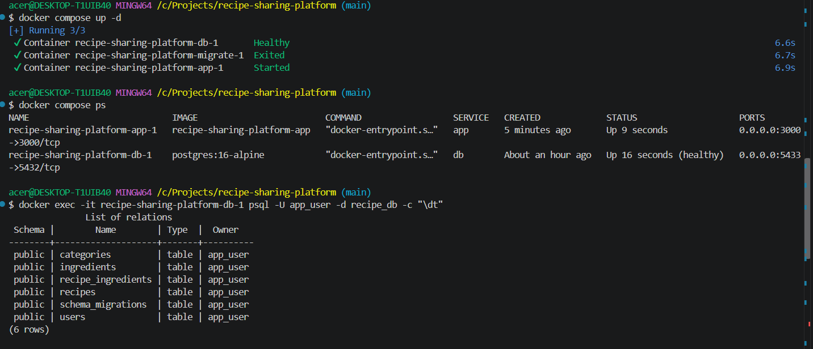

**2. Успешный Health Check (200 OK):**
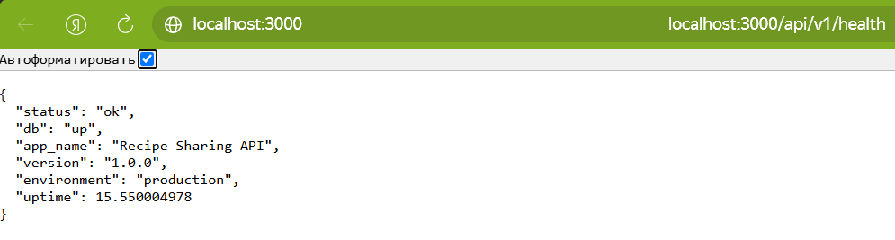

**3. Health Check при недоступной БД (503 Service Unavailable):**
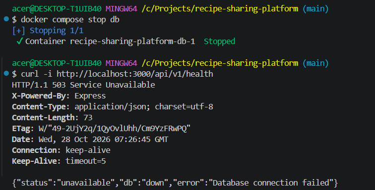

**4. Проверка сохранности данных при перезапуске:**
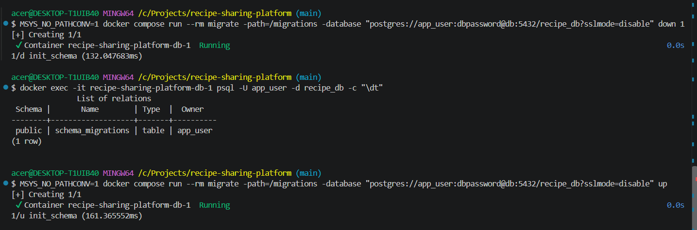

**5. Применение и откат миграций:**
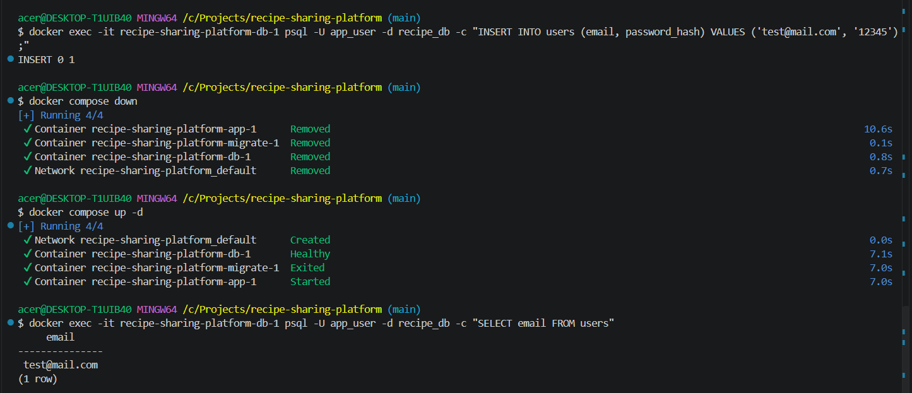
